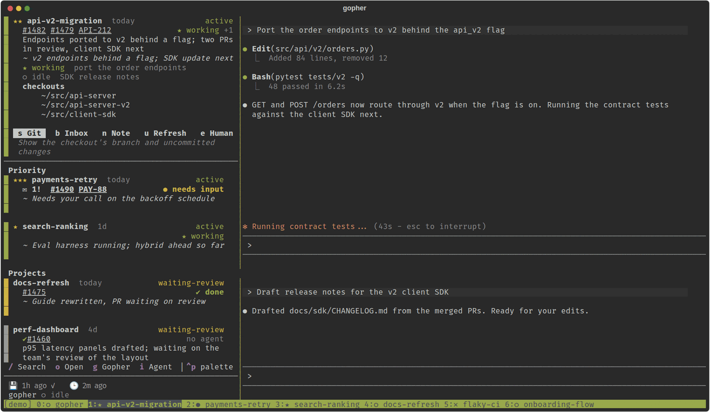
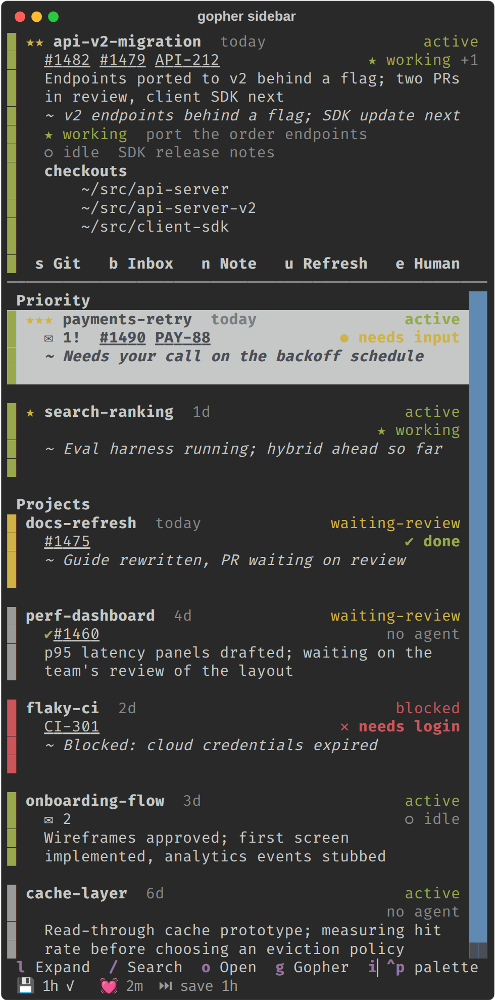
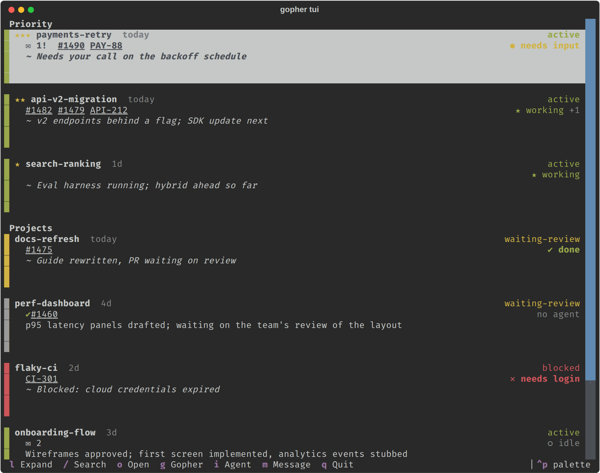

# claude-gopher

**Run a dozen Claude Code sessions at once without losing track of any of them.**

`gopher` gives each body of work a project with a home directory, its git checkouts, and its own
Claude Code agent in a tmux window. A live sidebar in every window shows what each agent is doing
and which ones need you. **Gopher**, a secretary agent one keypress away, takes anything you tell
it about any project and routes it to the right place.

<p align="center">
  
</p>

## Why

Once you have more than three or four agents going, the hard part is no longer the code. It's
remembering which agent is waiting on you, what each one was doing, where its notes are, and which
worktree belongs to what. gopher is built around a few ideas:

- **Projects, not sessions.** A session ends; a project persists. Each project keeps its status,
  plans, notes, resources, and inbox in a plain directory, so a new agent picks up exactly where
  the last one left off.
- **One glance tells you who needs you.** Hooks record each agent's state, and the sidebar sorts
  projects by urgency: waiting on input, finished and unseen, blocked on a login, working, idle.
- **Tell one agent, reach any project.** Gopher is a Claude Code session in tmux window 0 (and a
  `prefix g` popup). Say "tell payments the API changed" or "remind me to rebase search tomorrow"
  and it files an inbox item or messages that project's agent directly.
- **Email, not interrupts.** Inbox items wait politely: an agent mentions new mail and you decide
  when it acts. Mark an item `--wake` when it really should interrupt.
- **Plain files you own.** Everything lives in a *root* (default `~/workon`), a git repository
  you keep and back up. Gopher commits and pushes it on a timer. Your git checkouts are never
  written to; ownership is recorded only in the root.
- **Site-specific, not hard-coded.** Your build system, ticket tracker, and review flow go in the
  root's prompts and config, written for you by an interview during `gopher setup`.

## Highlights

- **Sidebar in every project window.** It pins that window's project at the top (summary, agents,
  checkouts, and buttons with a one-line hint for each), and lists the others below.
- **Priorities.** Give a project 0-3 stars with `+`/`-`; starred projects get their own section
  at the top.
- **Fuzzy search.** Press `/` and type letters in order (`pay` finds `payments-retry`) or a glob.
- **Jump straight to the agent.** `enter` takes you to the pane that needs you most.
- **Message from anywhere.** `g` messages Gopher about a project and `i` its agent, in a popup
  that closes when you send.
- **Close and restore windows.** `c` snapshots a project's tmux window (layout, panes, the Claude
  session id) and closes it. `o` brings it back with the agent resumed.
- **Custom actions.** Add a header button that runs any shell command for the pinned project in a
  popup, such as `git status` or your PR stack tool, scoped by checkout path.
- **Safe archive and close.** Close removes only git worktrees with nothing to lose: it is
  blocked by uncommitted changes or by commits that are on no remote. Every destructive step asks
  you to type `yes`.
- **Haiku summaries.** `r` asks Haiku for a one-line summary of any project; `l` expands a
  project into a detail view.
- **Gopher's record.** Gopher keeps a daily journal of what you told it and where it went, gives
  you a morning briefing and an end-of-day wrap, and can be `quiet`, `nudge`, or `proactive`
  about stalled projects. Optional features add an engineering notebook and a changelog of what
  shipped (see [Settings](#settings)).
- **Stays current.** Gopher checks for a new release every night and mentions it once; it
  updates only when you say so.

<p align="center">
  
  &nbsp;
  
</p>

*Above: made-up projects in every state. Green is active, yellow waiting on review, red blocked,
gray no open tmux window.
On the right of each block: needs input, done (finished, not yet seen), needs login (the agent
ran `gopher needs-login`), working, idle.*

## Requirements

- **[Claude Code](https://docs.claude.com/en/docs/claude-code)** on your `PATH` as `claude`.
  Agent-to-agent messaging needs v2.1.224 or later.
- **tmux.** Developed on 3.8; older versions are untested.
- **Python 3.11+** and **[uv](https://docs.astral.sh/uv/)**.
- **git.**
- Optional: **[tmux-resurrect](https://github.com/tmux-plugins/tmux-resurrect)** for closing and
  reopening project windows. **[tmux-assistant-resurrect](https://github.com/timvw/tmux-assistant-resurrect)** additionally records Claude session ids,
  so reopened windows resume their agent.

Developed on Linux; macOS is untested. gopher has had one user so far, so expect rough edges
(see [Known issues](#known-issues)).

## Getting started

```bash
# 1. Install
uv tool install git+https://github.com/Peaches491/claude-gopher@v0.1.3

# 2. Create a root, install the Claude Code hooks, and let Claude interview you about your setup
gopher setup                    # asks where the root goes (default ~/workon)

# 3. Shell integration (add to ~/.zshrc or ~/.bashrc)
eval "$(gopher shell-init zsh)" # the gopher function and completion; bash works too
alias workon='gopher workon'

# 4. tmux integration: add this line to ~/.tmux.conf, then reload tmux
#    run-shell 'tmux source-file "$(gopher shell-init tmux --path)"'

# 5. Check everything is wired up
gopher doctor
```

The tmux config ([`examples/tmux.conf`](examples/tmux.conf); the line above sources the installed
copy, so it follows updates) starts Gopher whenever a client attaches and links its window at index
0. It also binds `prefix g` to a popup on Gopher, replacing tmux 3.8's default `prefix g`. tmux
needs `gopher` on its `PATH`.

Then make a project and open it:

```bash
gopher project new my-feature --checkout ~/src/myrepo-my-feature
workon term my-feature          # in a tmux window: sidebar on the left, agent on the right
```

That's the daily loop: one window per project, Gopher in window 0, and `prefix g` to talk to
Gopher from anywhere.

## Concepts

### Roots

A root holds a deployment: `config.toml`, `prompts/` (your site's text, appended to the core
prompts), `schedule/` (Gopher's recurring tasks), `projects/`, `archived/`, `closed/`, `gopher/` (Gopher's own directory and journal),
`reference/` (a shared library of playbooks), and a gitignored `tmp/`. Roots are registered in
`$XDG_CONFIG_HOME/claude-gopher/config.toml`. Pick one with `--root` or `$GOPHER_HOME`; inside a
root, commands find it themselves.

```bash
gopher setup --review           # re-run the setup interview on an existing root
gopher new ~/work2 --name work2 # scriptable: create, git init, register (or --from <git-url>; --default-schedule)
```

### Projects

```
projects/<name>/
  STATUS.md        the agent's view: frontmatter (summary, state, updated) and where things stand
  human/           yours; agents read it and never write it (Gopher may, on your behalf)
  plan/ notes/     living plans; dated records of what happened
  resources/       one file per PR, ticket, doc, or dashboard the project uses
  inbox/           items for the project's agent; handled ones move to inbox/read/
  checkouts.toml   the git checkouts this project owns
```

`STATUS.md` frontmatter drives the sidebar:

```yaml
---
summary: One sentence on where the project stands.
state: active | blocked | waiting-review | closing
updated: 2026-11-17
---
```

```bash
gopher projects                         # overview: state, agents, unread inbox, checkouts, summary (--names, --json)
gopher agents                           # running agents and their tmux panes
gopher project new <name> [--checkout <path>]
gopher project rename <old> <new>       # also renames its windows and session records
gopher project priority <name> [0-3|+|-]
gopher checkout add <project> <path>    # or `gopher checkout add <path>` from inside a project dir
gopher checkout add --shared <p> <path>  # used across projects; close and archive leave it alone
gopher checkout move <path> <project>
gopher checkout list
```

### Agents and context

`gopher setup` installs Claude Code hooks (`gopher hook state|context|inbox`) in
`~/.claude/settings.json`:

- `context` tells every session in a project what the project is, where its files go, and what
  is in its inbox.
- `state` records whether each agent is working, waiting, or idle.
- `inbox` delivers new items as they arrive.

`gopher prompt <context>` prints the assembled instructions for any context.

```bash
workon agent my-feature -- --model opus  # an agent for the project in this terminal
workon source                            # cd + activate the checkout (finds the project from $PWD)
```

`[agents.<name>]`, `[[checkouts.setup]]`, and `[workon] pre_launch` in the root's `config.toml`
control how agents start.

### Inbox

```bash
gopher inbox add my-feature "rebase onto main when CI is green"   # mentioned on the next prompt
gopher inbox add my-feature --wake "stop: the API changed"        # delivered when the agent stops
gopher inbox list
```

Usually you just tell Gopher, which files these for you.

## The sidebar

`gopher tui --project <name>` is the sidebar. `workon term` starts one for you, and
`workon sidebar --all` adds one to every open project window. `gopher tui` without `--project`
is a full-width dashboard.

| Key | In the list |
|---|---|
| `j` / `k` | move (`k` at the top moves into the header) |
| `enter` | jump to the project's agent pane (and clear the search) |
| `/`, `escape` | filter the list; clear the filter |
| `+` / `-` | raise or lower priority |
| `o` / `c` | open the project's window (restoring its snapshot) / close it |
| `g` / `i` | message Gopher about it / message its agent |
| `m` / `M` | file an inbox item |
| `l` | expand into a detail view |
| `r` | one-line Haiku summary |
| `x` | mark finished work seen |
| `P` | cycle Gopher's proactivity |
| `.` | More for the highlighted project: `c` close its window, `A` archive, `X` close |
| `q` | quit the sidebar |

| Key | For the pinned project (also header buttons) |
|---|---|
| `h` / `l` | move between buttons; a hint below says what each does |
| `b` | show its inbox |
| `n` | new inbox item |
| `u` | ask its agent to refresh `STATUS.md` |
| `e` | edit `human/STATUS.md` in a popup |
| `.` | More: `Q` close this tab, `A` archive, `X` close project |

After a minute without input the sidebar resets to its header and the top of the list. Done
counts as seen after the agent's pane has had focus for a few seconds.

### Custom actions

Add buttons that run shell commands for the pinned project in a tmux popup:

```toml
[[tui.actions]]
key = "s"
label = "Status"
command = "git status --short --branch"
cwd = "checkout"          # "checkout" (default) or "project"
match = "~/src/*"         # optional: only projects with a checkout matching this glob
description = "Show uncommitted changes"   # shown when the button is focused
```

The command runs in the first matching checkout with `GOPHER_ROOT`, `GOPHER_PROJECT`, and
`GOPHER_PROJECT_DIR` set. A key that clashes with a built-in is skipped with a warning.

### Settings

```toml
[tui]
summary_lines = 2         # summary rows per project block (0 hides it)
idle_seconds = 60         # reset to the header after this long without input (0 never)
seen_dwell_seconds = 5    # pane focus needed before "done" counts as seen

[gopher]
model = "sonnet"          # model for the Gopher session
proactivity = "quiet"     # quiet | nudge | proactive
save_every_hours = 2      # save interval for a new schedule/save.md (0: no save task)
update_check = true       # add schedule/update-check.md to a new schedule
features = []             # any of "notebook", "changelog"
```

Gopher's optional features:
- `notebook`: a daily engineering notebook in `gopher/notebook/YYYY-MM-DD.md`, with what you worked
  on, decisions and why, findings, and links, by project. The journal records routing; the
  notebook records the work.
- `changelog`: `gopher/changelog.md`, one line per shipped thing (merged PR, closed ticket,
  deploy), newest first, which the weekly review draws on.

`gopher proactivity [quiet|nudge|proactive]` changes the proactivity level, as does `P` in the
sidebar.

## Project lifecycle

```bash
gopher archive <project>   # park it: move to archived/, run [lifecycle] on_archive in its checkouts
gopher close <project>     # end it: run on_close, remove its git worktrees, move to closed/
gopher reopen <project>    # bring an archived or closed project back
```

Each command prints its plan and waits for you to type `yes`. Use `--dry-run` to only print it.
Agents pass `--yes` only after you have approved the plan.

Close is conservative:
- It runs `git worktree remove` without force, then `git branch -d`.
- It keeps plain clones, paths listed in `[checkouts] protected`, shared checkouts, and checkouts
  another project also owns.
- Uncommitted changes, or commits that are on no remote, block it.
- An open project window is snapshotted and closed first.

Hooks get `GOPHER_PROJECT`, `GOPHER_CHECKOUT`, and `GOPHER_ROOT`:

```toml
[lifecycle]
on_archive = ["make clean"]
on_close = []
on_remove = []            # runs in the main checkout after each worktree is removed
```

## Project windows

```bash
gopher workon close <project>     # snapshot the window via tmux-resurrect, then close it
gopher workon open <project>      # rebuild it from the snapshot, back at its old index, agent resumed
gopher workon snapshot <project>  # snapshot without closing
```

With no snapshot, `open` lays out the standard sidebar and agent.

## Saving the root

`gopher save` commits the root's changes, one commit per project plus one for the root's own
files, then pushes. `--no-push` skips the push; `--dry-run` previews. The `save` schedule task
runs it every two hours by default; Gopher also runs it at the end-of-day wrap and when you ask.
The root needs to be a git repository with an upstream to push to.

The bottom line of every sidebar shows the backup and the schedule, e.g.
`💾 39m (+35 -23 ~6)  🕒 3m  ➡️  standup in 1h 21m`: time since the last save, unsaved lines
added, removed, and files changed in green, red, and yellow (✓ when clean, ⇡ for unpushed
commits), then the last schedule tick and the next task due (tasks marked `background: true`,
such as gopher's own save and update check, stay out of it). The backup turns yellow when changes have waited longer than the save
task's interval (plus half an hour) without a save, and red when the root is not a git
repository or has no upstream.

## The schedule

Gopher's recurring work lives in the root's `schedule/` directory, one markdown file per task,
so you can read, edit, and version it like the rest of the root, or ask Gopher to:

```markdown
---
every: 10m            # or at: "08:45"; optional days: weekdays, until: 2026-12-01
---
Read the release thread and route any bug reports to the api-v2-migration inbox.
```

`run: <command>` makes the tick run a command first and hand Gopher its output. New roots start
with `save.md` (`gopher save` every two hours) and `update-check.md` (nightly at 00:03):
`gopher new` and `gopher setup` show them and ask whether to keep, retime, or drop each, and
what else to add (`--default-schedule` skips the questions). The setup interview reviews the
schedule too.

The schedule runs outside Claude: `gopher launch` starts `gopher schedule run` in a hidden window
of the gopher tmux session, which ticks every ten minutes, runs what is due, and reports events
(the backup running overdue; at the `proactive` level, projects whose STATUS has not moved in five
working days). Routine runs stay silent: `notify: failure` (the default for `save`) speaks only
when the command fails, and `notify: change` (for `update-check`) only when its answer changes.
`background: true` (the default for both) keeps a housekeeping task off the sidebar's "next".
When a tick has something for Gopher, the loop types one line into Gopher's pane once Gopher is
idle with an empty input line, or attaches it to your next message to Gopher. `gopher schedule`
lists the tasks with their last and next runs; the clock on the sidebar's bottom line turns
yellow after half an hour without a tick.

## Health check

`gopher doctor` checks the install and the root in one pass: hooks installed and pointing at a
real `gopher`, tmux config loaded and Gopher running, the backup, the schedule loop, and
checkouts that are missing or owned by two projects without being shared. It exits non-zero on a problem; `-q` shows
only what needs attention.

To report a bug, run `gopher doctor --report "<title>" --description "<what happened>"`. It drafts
an issue with the doctor results and your versions (your home directory shown as `~`), and lists
existing issues that look like a match. It posts only with `--yes` (a new issue) or `--comment N`
(added to issue N), using the GitHub CLI; without `gh`, file it with the
[bug report form](https://github.com/Peaches491/claude-gopher/issues/new?template=bug_report.yml).
Ask Gopher to report a problem and it runs the draft and shows it to you before posting.

## Updating

```bash
gopher update --check            # is there a newer release?
gopher update                    # install it (asks you to type yes)
gopher workon sidebar --all --restart
gopher launch --restart --continue   # restart Gopher, keeping its conversation
```

The `update-check` schedule task runs the check nightly; Gopher does all of this for you when you say yes. An editable install
(`uv tool install -e .`) is updated with `git pull` instead. `gopher launch --restart` without
`--continue` starts Gopher fresh.

## Uninstalling

```bash
gopher setup --remove-hooks      # take gopher's hooks out of ~/.claude/settings.json (backed up first)
uv tool uninstall claude-gopher
```

Also remove the `run-shell` line from your tmux config and the `shell-init` line from your shell
rc. Your roots are plain directories; keep or delete them as you like.

## Known issues

- tmux-resurrect does not understand linked windows. Restoring a tmux session may bring Gopher
  back as two windows.
- While a popup is open, the pane underneath it counts as focused, so its "done" can be marked
  seen.

## Development

```bash
uv sync
uv run pytest
scripts/demo-render.sh            # regenerate the README images from made-up projects
```

[docs/design.md](docs/design.md) is the design and its decisions.
[CONTRIBUTING.md](CONTRIBUTING.md) covers tests, the demo images, and style.

If you hack on the sidebar, there is an opt-in reloader:
1. Set `[dev] reload = true` in the root's `config.toml`.
2. Install with `uv tool install -e '.[dev]'`.
3. Run `gopher dev reload`. It checks that the TUI starts, then restarts every running sidebar on
   the new code.

## License

[MIT](LICENSE)
